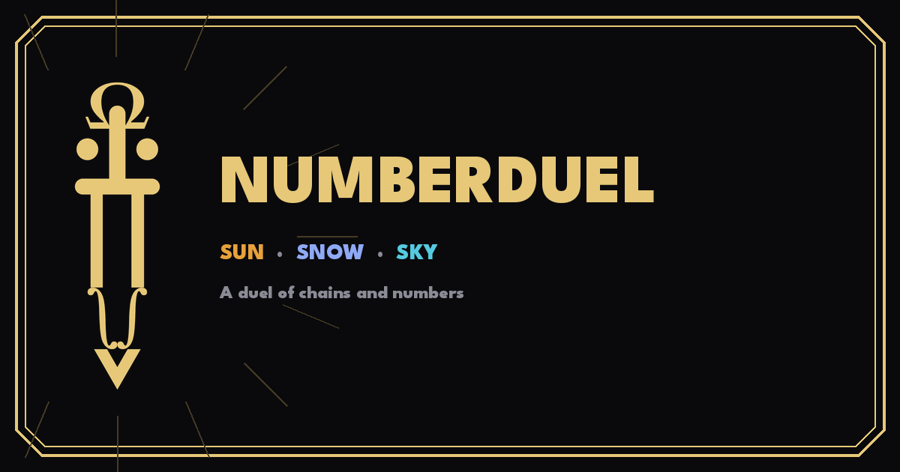
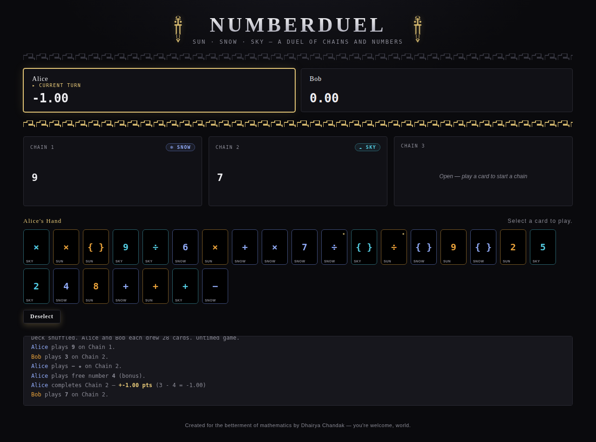

# NUMBERDUEL



A two-player card game where you build math expression "chains" across
three elements — **Sun**, **Snow**, and **Sky** — racing to complete
computable chains before your opponent. Play locally against a friend, or
duel a built-in AI opponent.

## Play it

Once GitHub Pages is enabled for this repo (see setup below), the game is
live at:

```
https://<your-username>.github.io/numberduel/
```

## Screenshot



## Features

- **2 Players or vs AI** — local pass-and-play, or a single-player practice
  opponent (its hand stays hidden, just like a real match).
- **Chains & brackets** — build expressions across 3 open chains at once;
  brackets self-close the instant their contents become computable.
- **Star cards (★)** — one ÷ and one − per element grant a free bonus number
  play.
- **Optional turn timer** — pick a per-turn clock and a time-out penalty to
  keep games moving without enabling free stalling.
- **Confirm-before-you-commit** — a misclick can't lock in a move; every
  placement gets a ghost preview plus Confirm/Cancel.
- **Post-game breakdown** — biggest chain, most-used element, average chain
  value, and longest bracket expression at the end of every duel.

## Running it locally

No installation needed — it's a single self-contained HTML file.
Just download `index.html` and open it in any web browser.

## How to play

Full rules are built into the game itself — click **"How to Play"** on the
setup screen before starting a duel, or open the standalone
[`rules.html`](rules.html) page any time, even outside the game.
